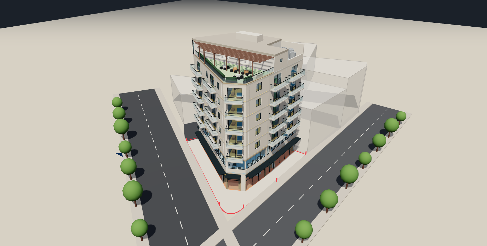

<div align="center">

# 🏙️ Building 3D Viewer

### نموذج ثلاثي الأبعاد تفاعلي — مبنى المحضر 2310/4

**Interactive 3D model of a 9-storey mixed-use building on parcel 2310/4 (529 m²)**

<br/>


<br/>

[✨ Features](#-features) ·
[🏢 The Building](#-the-building) ·
[🚀 Getting Started](#-getting-started) ·
[🎮 Controls](#-controls) ·
[⚙️ Customize](#️-customize) ·
[🗂️ Project Structure](#️-project-structure)

<br/>



<sub>Corner lot with three road frontages · rooftop café with pergola · balconies on every residential floor</sub>

</div>

---

## 📖 Overview

An interactive, explorable 3D model of a planned building, rendered in the browser with **Three.js**. Click any unit to see its area, balcony, orientation and view, walk through the interior in first person, slice the building with a vertical section, and follow the sun's shadows across the day.

The parcel geometry is **solved from the surveyed edge lengths and area** (not traced by eye), and every floor plan is generated procedurally from a single config file. Change a setback or a floor height and the units, areas and layouts regenerate automatically.

كل شي بالنموذج مولَّد برمجياً من ملف إعدادات واحد، وإحداثيات المحضر محسوبة من أطوال الأضلاع والمساحة الفعلية. عدّل ارتداداً أو ارتفاع طابق، وتتحدّث الوحدات والمساحات والمخططات تلقائياً.

---

## ✨ Features

| | |
|---|---|
| 🏗️ **Procedural floor plans** | Units, cores, halls and ramps generated from config; areas recomputed on every change |
| 🔍 **Click-to-inspect units** | Area, balcony, orientation, view, plus sale status and price (saved in your browser) |
| 🪜 **Dollhouse floor selector** | Pick a level and the floors above it lift away |
| 💥 **Exploded view** | Pull every storey apart to read the stack |
| ✂️ **Vertical section cut** | Slice the building to see inside |
| ☀️ **Sun & shadows** | Scrub the hour of day and watch the shadows move |
| 🚶 **First-person walk mode** | `W A S D` + mouse look through the interior |
| 🧱 **Layer toggles & facade transparency** | Isolate structure, partitions, facades |
| 📊 **Area schedule** | Full table of spaces with **CSV export** |
| 📸 **Screenshot** | One-click capture of the current view |
| 🔗 **Deep links** | Share an exact view via URL parameters |
| 🌐 **Arabic RTL interface** | IBM Plex Sans Arabic, right-to-left layout |
| 📦 **One-file build** | `dist/index.html` opens directly in any browser, no server needed |

---

## 🏢 The Building

**529 m² corner lot · 3 road frontages · 1 shared boundary · 9 storeys + roof**

| Level | Program |
|---|---|
| **B2, B1** | Parking (17 stalls) + stacked ramp along the shared boundary + service rooms |
| **Ground** | 4 retail shops (41.2 m² each) + separate residential entrance + waste room |
| **1st** | 4 offices (56–64 m²) + restrooms and shared kitchen |
| **2 → 6** | 6 studios per floor — **30 studios**, 39.4 m² each + balcony |
| **Roof** | Café: indoor hall + kitchen + restrooms + pergola terrace + technical zone |

<details>
<summary><b>🇸🇦 بالعربي</b></summary>

<div dir="rtl">

| المستوى | الاستخدام |
|---|---|
| **B2, B1** | باركينغ (17 موقفاً) + رامب مكدّس على الحد المشترك + غرف خدمات |
| **الأرضي** | 4 محلات تجارية (41.2 م² لكل محل) + مدخل سكن مستقل + غرفة نفايات |
| **الأول** | 4 مكاتب (56–64 م²) + حمامات ومطبخ مشترك |
| **2 → 6** | 6 استوديوهات في كل طابق (30 استوديو، 39.4 م² + بلكون) |
| **السطح** | مقهى: صالة داخلية + مطبخ + حمامات + تراس مع برغولا + منطقة تقنية |

</div>

</details>

---

## 🚀 Getting Started

**Requirements:** [Node.js](https://nodejs.org) 18+

```bash
# 1. Clone
git clone https://github.com/mohammedsalehsamman/building-3d-viewer.git
cd building-3d-viewer

# 2. Install (once)
npm install

# 3. Run locally → open the printed URL (usually http://localhost:5173)
npm run dev

# 4. Build a single shareable file → dist/index.html
npm run build
```

### Scripts

| Command | What it does |
|---|---|
| `npm run dev` | Start the Vite dev server |
| `npm run build` | Build one self-contained `dist/index.html` |
| `npm run preview` | Preview the production build |
| `npm run check` | Verify units cover every floor with no overlap, and print the area table |
| `npm run solve` | Recompute the parcel coordinates from edge lengths and the 529 m² area |

---

## 🎮 Controls

| Action | Input |
|---|---|
| Rotate | **Drag** |
| Zoom | **Mouse wheel** |
| Pan | **Right-click + drag** |
| Open a floor (dollhouse) | Floor list on the side |
| Unit info card | **Click** a unit |
| Walk mode | Toolbar → walk, then `W A S D` + drag to look, `Esc` to exit |

**Toolbar:** explode floors · facade transparency · vertical section · sun & shadows · layers · walk mode · area schedule (CSV) · screenshot.

### 🔗 Deep links

| Parameter | Example | Effect |
|---|---|---|
| `level` | `?level=F3` | Open a specific floor |
| `space` | `?space=F3-S06` | Focus a specific unit |
| `explode` | `?explode=1` | Start in exploded view |
| `hour` | `?hour=8` | Set the sun to 08:00 |

Combine them: `?level=F3&hour=16`

---

## ⚙️ Customize

Every number lives in one file: [`src/config/site.js`](src/config/site.js)

| Constant | Meaning |
|---|---|
| `SETBACKS` | Setback from each edge (default 3 m on the two roads, 2.5 m on the internal road, 0 on the shared wall) — **adjust to the official urban-planning certificate** |
| `NORTH_IN_DRAWING` | True-north direction. Current value is estimated from the survey photo and needs confirmation |
| `LEVELS` | Floor heights |
| `CORE`, `HALL`, `RAMP` | Position of stairs/lifts, corridor and car ramp |

After any change, layouts and areas regenerate automatically. Then verify:

```bash
npm run check
```

---

## 🗂️ Project Structure

```
building-3d-viewer/
├── index.html              # Arabic RTL shell + UI containers
├── vite.config.js          # Vite + single-file plugin
├── scripts/
│   ├── solve-parcel.mjs    # Solve parcel coordinates from edge lengths + area
│   ├── check-layouts.mjs   # Validate coverage / overlaps, print area table
│   └── plan-preview.mjs    # Export an SVG sheet of every level
└── src/
    ├── main.js             # Entry point
    ├── config/             # parcel.js, site.js — all dimensions & setbacks
    ├── geometry/           # Polygon math (clip, inset, centroid, area)
    ├── program/            # Floor programs, unit types, fan layout, interiors
    ├── build/              # Three.js meshes: site, building, materials, batching
    ├── interaction/        # Orbit camera rig + first-person walk mode
    └── ui/                 # Toolbar, panels, floor list, schedule, styles
```

---

## 📝 Notes & Assumptions

- Parcel coordinates are computed from the surveyed edge lengths (13.54, 22.45, 13.18 + 10.81, 26.24 m) and the 529 m² area, accurate to **±2 mm**.
- Neighbouring parcels' positions and heights are **estimates**, shown for context only.
- Parking (17 stalls) is fewer than the studio count (30); it can be doubled with mechanical parking systems on B2.
- Setbacks and true north are **assumptions** until confirmed against the official documents.

> ⚠️ **Disclaimer** — This is a preliminary visualization for study and presentation. It is **not** a construction drawing and must be reviewed and approved by a licensed engineer.

<details>
<summary><b>🇸🇦 ملاحظات وافتراضات</b></summary>

<div dir="rtl">

- إحداثيات المحضر محسوبة من أطوال الأضلاع على المخطط (13.54، 22.45، 13.18 + 10.81، 26.24) والمساحة 529 م²، بدقة ±2 مم.
- مواقع وارتفاعات المحاضر المجاورة **تقديرية** للسياق فقط.
- عدد المواقف (17) أقل من عدد الاستوديوهات (30)؛ يمكن مضاعفته بأنظمة ركن ميكانيكية في B2.
- الارتدادات واتجاه الشمال **افتراضات** إلى أن تُؤكَّد من الوثائق الرسمية.
- هذا تصوّر أولي للدراسة والعرض، وليس مخططاً تنفيذياً؛ يجب اعتماده من مهندس مرخّص.

</div>

</details>

---

<div align="center">

Built with ❤️ using [Three.js](https://threejs.org) and [Vite](https://vitejs.dev)

</div>
